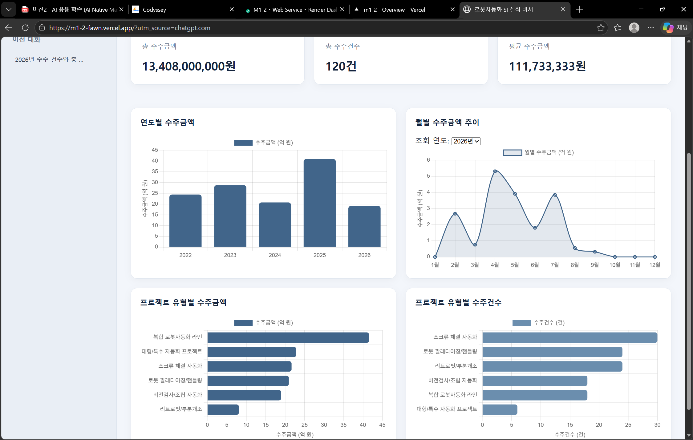
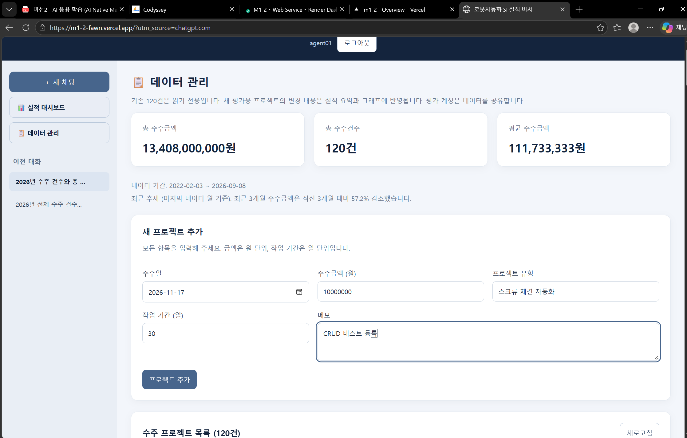
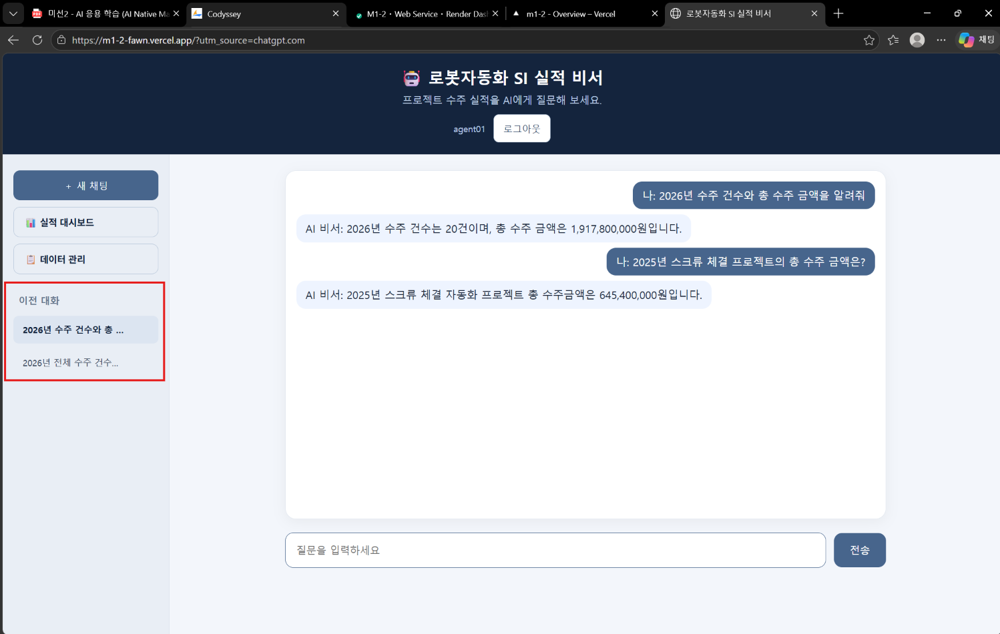

# M1-2 AI Agent 개발: 나만의 AI 비서 구축
# 🤖 로봇자동화 SI 실적 AI 비서
## 1. 프로젝트 소개

### 배경

로봇자동화 SI(System Integration)는 고객사의 요구에 맞춰 자동화 설비를 설계하고 구축하는 프로젝트 중심의 사업이다.  
프로젝트마다 수주 시점과 금액이 다르기 때문에 월별·연도별 실적을 비교하고 전체 사업 흐름을 파악하는 것이 중요하지만,  
수주 실적이 여러 데이터로 관리되면 원하는 정보를 확인할 때마다 직접 조회하고 계산해야 하는 불편함이 있다.  
이러한 문제를 해결하기 위해 **수주 데이터를 한눈에 확인하고, AI에게 질문하여 실적을 분석할 수 있는 서비스**를 개발하였다.  

### 목표

- 수주 실적을 체계적으로 저장하고 관리
- 월별·연도별 실적을 그래프로 시각화
- AI 채팅을 통해 실적 정보를 쉽게 조회
- 이전 대화 내용을 저장하고 다시 불러오기
- 실제 웹사이트에 배포하여 이용할 수 있도록 구현

---

## 2. 데이터 선정 및 분석

### 2.1. 데이터 선정

본 프로젝트에서는 **로봇자동화 SI 기업의 수주 실적**을 분석 대상으로 선정

실제 기업의 영업 정보를 사용하지 않고, 제조업 프로젝트 수주의 특성을 반영한 가상 데이터를 생성하여 사용

| 항목 | 내용 |
|:---:|:---:|
| 데이터 종류 | 로봇자동화 SI 수주 실적 |
| 데이터 기간 | 2022년~2026년 |
| 기본 데이터 수 | 120건 |
| 데이터 형식 | CSV |
| 데이터 성격 | 가상 데이터(Synthetic Data) |
| 분석 기준 | 수주 시점, 수주 금액, 프로젝트 유형 등 |

데이터 파일: `robot_si_synthetic_2022_2026.csv`

### 2.2. 데이터 분석 방법

저장된 수주 데이터를 월별·연도별로 집계하여 다음 정보를 분석

- 연도별 총수주 금액
- 연도별 수주 건수
- 월별 수주 금액과 건수
- 평균 수주 금액
- 프로젝트 유형별 실적
- 기간별 실적 변화

수주가 없는 달은 건수와 합계를 `0`으로 표시하고, 계산할 대상이 없는 평균값은 별도로 처리하도록 구성

### 2.3. AI가 데이터를 활용하는 방법

일반적인 AI는 사용자의 수주 실적을 알지 못한다.

본 프로젝트에서는 다음과 같은 과정을 통해 AI가 데이터를 참고하도록 구현

```text
사용자가 실적 질문 입력
         ↓
Firestore에서 수주 데이터 조회
         ↓
수주 금액·건수 등 데이터 요약
         ↓
요약 정보를 AI에게 전달
         ↓
GPT가 답변 생성
         ↓
채팅 화면에 답변 표시
         ↓
대화 기록 저장
```

이처럼 데이터 요약 정보를 AI에게 함께 전달하는 방식을 **컨텍스트 주입(Context Injection)** 이라고 한다.

---

## 3. 사용 기술

| 구분 | 사용 기술 | 역할 |
|:---:|:---:|:---:|
| 백엔드 | Python, FastAPI | 데이터 처리 및 API 개발 |
| 프론트엔드 | HTML, CSS, JavaScript | 웹 화면 구현 |
| 데이터베이스 | Firebase Firestore | 수주 데이터 및 대화 기록 저장 |
| AI | gpt-5-mini | 실적 질문에 대한 답변 생성 |
| 시각화 | Chart.js | 수주 실적 그래프 |
| 백엔드 배포 | Render | 서버 운영 |
| 프론트엔드 배포 | Vercel | 웹사이트 운영 |
| 형상 관리 | Git, GitHub | 소스 코드 관리 |

---

## 4. 시스템 구성

```text
              사용자
                │
                ▼
       웹사이트 (Vercel)
                │
                ▼
       백엔드 (FastAPI)
                │
       ┌────────┴────────┐
       ▼                 ▼
 Firebase Firestore    GPT API
       │                 │
  수주 데이터 저장     AI 답변 생성
  대화 기록 저장
```

### 데이터 저장 방식

Firebase Firestore를 사용하여 데이터를 관리
기본 수주 데이터와 평가용 데이터를 분리해 기존 데이터가 변경되지 않도록 구성

| 데이터 | 용도 |
|:---:|:---:|
| `data` | 기본 수주 데이터 120건 |
| `evaluation_data` | 평가자가 추가·수정·삭제하는 프로젝트 |
| `conversations` | 기존 대화 기록 |
| `evaluation_conversations` | 평가용 대화 기록 |

이 외에도 로그인과 세션 관리를 위한 데이터를 별도로 사용

---

## 5. 서비스 이용하기

| 구분 | 링크 |
|:---:|:---:|
| 웹 서비스 | https://m1-2-fawn.vercel.app |
| GitHub 저장소 | https://github.com/codyssey-siyul/M1-2 |
| 백엔드 API | https://m1-2-8d9s.onrender.com |
| API 문서(Swagger) | https://m1-2-fawn.vercel.app/docs |

### 이용 방법

1. 웹 서비스에 접속
2. 안내받은 평가용 계정으로 로그인
3. 대시보드에서 수주 실적을 확인
4. AI 채팅에서 실적에 관한 질문을 입력
5. 데이터 관리 화면에서 평가용 프로젝트를 추가·수정·삭제 가능
6. 대화 목록에서 이전 대화를 다시 확인 가능

**참고 사항**

- 평가용 로그인 정보는 별도로 전달
- Render 무료 서비스 특성상 첫 접속 시 로딩이 길어질 수 있다.
- AI는 실제 GPT API를 사용하므로 일부 질문에서 응답 오류가 발생할 수 있다.
- **Swagger UI(API 문서)는 로그인 후 이용할 수 있다.** 웹서비스에 평가용 계정으로 로그인한 다음, 동일한 브라우저에서 [Swagger UI](https://m1-2-fawn.vercel.app/docs)에 접속
- 백엔드(Render) 주소로 직접 접속하면 인증 오류가 발생할 수 있으므로, API 문서는 Vercel 주소를 이용
  
---

## 6. 주요 기능

### 6.1. AI 실적 분석 채팅

사용자가 자연어로 질문하면 저장된 수주 실적 데이터를 참고하여 AI가 답변

**질문 예시**

- "2026년 수주 실적을 알려줘."
- "2025년과 2026년 수주 실적을 비교해 줘."
- "수주 금액이 가장 높았던 연도는 언제야?"
- "연도별 수주 추세를 분석해 줘."

AI는 데이터베이스에서 생성한 실적 요약 정보를 참고하여 답변

질문을 입력하면 응답을 기다리는 동안 로딩 상태가 표시되고, 완료된 대화는 자동으로 저장

**[스크린샷 ① AI 채팅 화면]**

  

---

### 6.2. 수주 실적 대시보드

수주 실적을 숫자와 그래프로 확인할 수 있는 화면

**주요 기능**

- 연도별 수주 실적 요약 카드
- 월별·연도별 수주 실적 그래프
- 총수주 금액 및 수주 건수 확인
- 연도 선택 필터
- 수주 실적의 변화 추세 확인

총 4개의 그래프를 통해 데이터를 시각적으로 비교 가능

**[스크린샷 ② 실적 대시보드]**

  

---

### 6.3. 수주 데이터 관리(CRUD)

수주 실적 데이터를 직접 추가하고 관리

| 기능 | 설명 |
|---|---|
| 추가(Create) | 새로운 프로젝트 수주 데이터 등록 |
| 조회(Read) | 저장된 프로젝트 목록 확인 |
| 수정(Update) | 추가한 프로젝트 정보 변경 |
| 삭제(Delete) | 추가한 프로젝트 삭제 |

평가 과정에서 기존 데이터가 변경되는 것을 방지하기 위해 **기본 수주 데이터 120건은 읽기 전용으로 보호**

평가자는 새로운 프로젝트를 등록하고, 직접 등록한 프로젝트에 대해 수정 및 삭제 기능을 사용할 수 있다.

추가한 프로젝트의 실적은 데이터 목록뿐 아니라 대시보드와 AI 분석에도 반영

**[스크린샷 ③ 데이터 관리 화면]**

  

---

### 6.4. AI 대화 기록 관리

AI와 나눈 대화 내용을 저장하고 다시 확인

**주요 기능**

- 대화 내용 자동 저장
- 이전 대화 목록 조회
- 선택한 대화 불러오기
- 기존 대화 이어서 진행
- 새 채팅 시작
- 대화 기록 삭제  

**[스크린샷 ④ 삽입 — 대화 기록 화면]**

  

---

## 7. 로컬 실행 방법

본 프로젝트는 Python 3.10 이상 환경에서 실행할 수 있도록 구성했다.

### 7.1. 프로젝트 다운로드

```bash
git clone https://github.com/codyssey-siyul/M1-2.git
cd M1-2
```

### 7.2. 가상환경 생성 및 패키지 설치

Windows PowerShell 기준

```powershell
python -m venv .venv
.\.venv\Scripts\python.exe -m pip install -r requirements.txt
```

### 7.3. 환경 변수 설정

`.env.example` 파일을 참고하여 필요한 환경 변수를 설정

| 항목 | 설명 |
|:---:|:---:|
| `OPENAI_API_KEY` | AI API 인증 키 |
| `OPENAI_MODEL` | 사용할 AI 모델 |
| `OPENAI_BASE_URL` | AI API 접속 주소(필요한 경우) |
| `FIREBASE_SERVICE_ACCOUNT_JSON` | Firebase 인증 정보 |
| `EVAL_USERNAME` | 로그인 계정 |
| `EVAL_PASSWORD_HASH` | 로그인 비밀번호 검증값 |
| `AUTH_SECRET` | 로그인 세션 보호용 비밀값 |
| `AUTH_ALLOWED_ORIGINS` | 허용할 웹사이트 주소 |

Firebase 인증 정보는 환경 변수 또는 인증 파일 경로 방식으로 설정할 수 있다.

로그인에 필요한 로컬 설정은 다음 도구를 이용하여 준비할 수 있다.

```powershell
.\.venv\Scripts\python.exe tools\setup_local_auth.py
```

설정값은 `.env`, `.env.auth` 등에 저장하며, 실제 API 키와 비밀번호는 GitHub에 업로드하지 않는다.

### 7.4. 백엔드 실행

```powershell
.\.venv\Scripts\python.exe -m uvicorn main:app --host 127.0.0.1 --port 8000
```

실행 후 아래 주소로 접속

- 웹 화면: http://127.0.0.1:8000/app
- API 문서: http://127.0.0.1:8000/docs

로그인 설정이 완료되어야 서비스를 이용할 수 있다.

---

## 8. 배포 및 테스트

### 8.1. 배포

백엔드는 Render, 프론트엔드는 Vercel에 배포

프론트엔드에서 전달한 요청은 백엔드로 연결되며, 백엔드는 Firestore와 GPT API를 이용하여 요청을 처리

### 8.2. 주요 기능 테스트

| 테스트 항목 | 확인 결과 |
|:---:|:---:|
| 로그인 | 정상 동작 확인 |
| 대시보드 | 요약 카드·그래프·연도 필터 확인 |
| 데이터 추가 | 정상 동작 확인 |
| 데이터 수정 | 정상 동작 확인 |
| 데이터 삭제 | 정상 동작 확인 |
| AI 채팅 | 실제 GPT 답변 생성 확인 |
| 대화 기록 저장 | 정상 동작 확인 |
| 이전 대화 불러오기 | 정상 동작 확인 |
| 웹 배포 | Render 및 Vercel 접속 확인 |

**AI 채팅 참고 사항**

실제 GPT 응답을 확인했지만, 일부 질문에서는 응답 오류가 발생했다. 향후 AI 응답 안정성을 개선할 예정

---

## 9. 개발 과정에서 배운 점

이번 프로젝트를 통해 단순히 AI에게 질문하는 기능을 넘어, **내가 선택한 데이터를 AI가 활용하도록 만드는 과정**을 경험

특히 다음 내용을 학습할 수 있었다.

- 시계열 데이터를 분석하고 요약하는 방법
- FastAPI를 활용한 웹 API 개발
- Firestore를 이용한 데이터 저장과 관리
- AI에 데이터 요약 정보를 전달하는 방법
- HTML, CSS, JavaScript를 이용한 웹 화면 구현
- Render와 Vercel을 이용한 서비스 배포
- 로그인과 API 키 보호의 중요성

---

## 10. 향후 개선 방향

현재 구현한 기능을 기반으로 다음 사항을 개선

1. **AI 응답 안정성 향상**  
   일부 질문에서 발생하는 응답 오류를 개선

2. **실적 분석 기능 확대**  
   프로젝트 유형별 비교와 다양한 통계 지표를 추가

3. **사용자 편의성 개선**  
   화면 구성과 데이터 조회 기능을 개선

4. **실제 기업 데이터 연동**  
   향후 실제 기업의 수주 관리 업무에 활용할 수 있도록 확장 가능성을 검토

